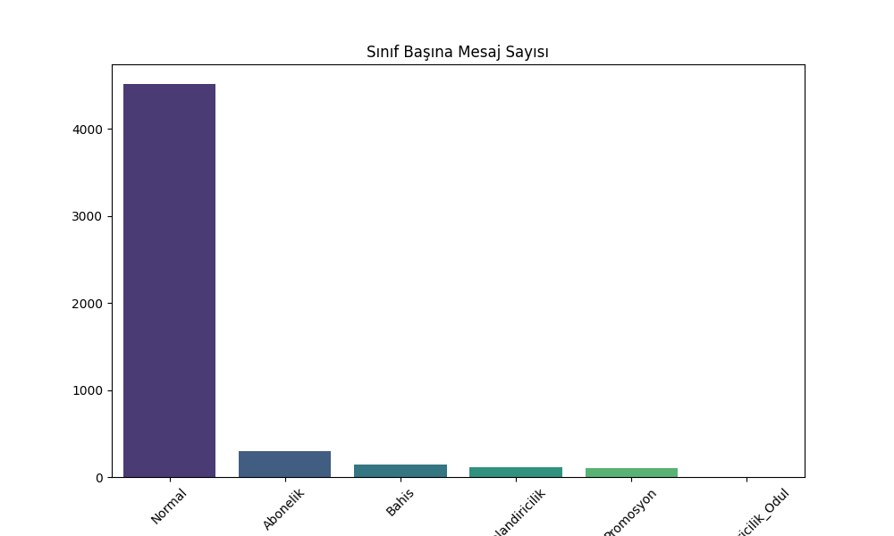
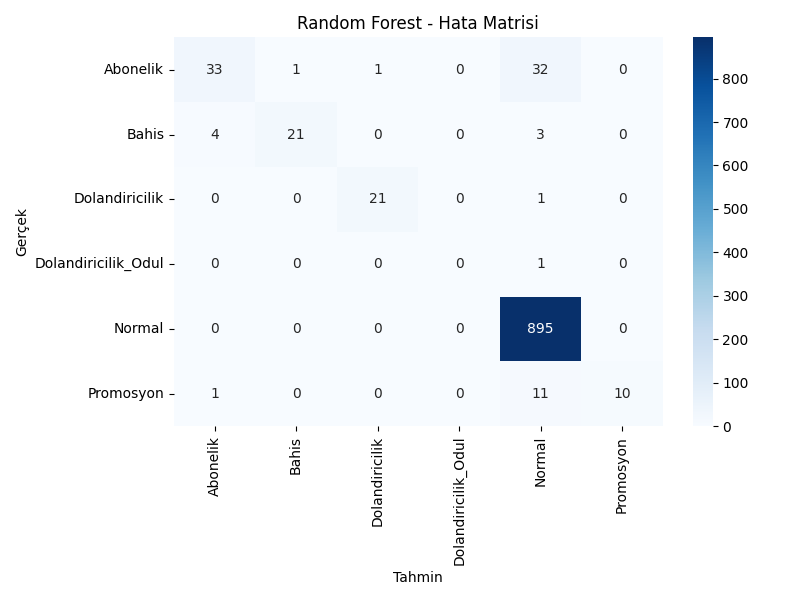

# Akıllı SMS Güvenlik Duvarı

Makine öğrenmesi ve doğal dil işleme (NLP) kullanarak SMS mesajlarını analiz eden, normal mesajları spam içeriklerden ayıran ve spam mesajlarını alt kategorilere sınıflandıran Streamlit uygulaması.


## Proje hakkında

Bu proje, bir SMS mesajını TF-IDF ile sayısal özelliklere dönüştürür ve ağırlıklandırılmış Random Forest modeliyle sınıflandırır. Sistem yalnızca `Normal` ve `Spam` ayrımı yapmakla kalmaz; spam mesajını aşağıdaki kategorilerden birine de atar:

- Abonelik / hizmet
- Dolandırıcılık / ödül
- Bahis / yarışma
- Cihaz / promosyon

Uygulama tahmin sonucunu güven skoruyla gösterir, ilgili spam kategorisi için kelime bulutu üretir ve yanlış tahminleri sonraki eğitimlerde kullanılmak üzere geri bildirim olarak kaydeder.

## Öne çıkan özellikler

- Metin temizleme, İngilizce stop-word çıkarma ve Porter stemming
- TF-IDF tabanlı özellik çıkarımı
- K-Means ile spam mesajlarını dört kümeye ayırma
- Beş farklı sınıflandırma algoritmasını karşılaştırma
- Sınıf dengesizliği için ağırlıklandırılmış Random Forest
- Düşük güvenli sonuçlar için hibrit risk kontrolü
- Kullanıcı geri bildirimiyle yeniden eğitime veri sağlama
- Streamlit tabanlı, etkileşimli web arayüzü
- Confusion matrix, veri dağılımı ve model karşılaştırma grafikleri

## Model sonuçları

Proje kapsamında oluşturulan değerlendirme raporlarındaki doğruluk değerleri:

| Model | Doğruluk |
|---|---:|
| Random Forest | **%94,69** |
| Logistic Regression | %93,91 |
| Decision Tree | %93,82 |
| Naive Bayes | %92,37 |
| K-Nearest Neighbors | %90,34 |

> Bu değerler mevcut veri bölümü ve proje içindeki rapor çıktıları için geçerlidir. Veri dağılımı dengesiz olduğundan modeli değerlendirirken sınıf bazlı precision, recall ve F1-score değerleri de dikkate alınmalıdır.


## Çalışma akışı

```text
Ham SMS verisi
      │
      ▼
Veri temizleme ve tekrarların kaldırılması
      │
      ▼
Spam mesajların K-Means ile kümelenmesi
      │
      ▼
Metin ön işleme + TF-IDF
      │
      ▼
Model eğitimi ve karşılaştırma
      │
      ▼
Random Forest modeli + Streamlit arayüzü
```

## Kurulum

### 1. Projeyi klonlayın

```bash
git clone <REPO_URL>
cd SMS_Spam_Projesi
```

### 2. Sanal ortam oluşturun

Windows PowerShell:

```powershell
python -m venv .venv
.\.venv\Scripts\Activate.ps1
```

macOS / Linux:

```bash
python3 -m venv .venv
source .venv/bin/activate
```

### 3. Bağımlılıkları yükleyin

```bash
pip install -r requirements.txt
```

İlk çalıştırmada NLTK stop-word verisi otomatik olarak indirilir.

## Kullanım

Web uygulamasını başlatmak için:

```bash
streamlit run 06_final_proje.py
```

Tarayıcıda açılan arayüze analiz etmek istediğiniz İngilizce SMS metnini girin ve **Analiz Et** düğmesine basın.

## Modeli baştan üretme

Veri işleme ve eğitim hattını sırasıyla çalıştırabilirsiniz:

```bash
python 01_veri_hazirligi.py
python 02_kumeleme_etiketleme.py
python 03_model_egitimi.py
```

Bu işlem `spam_model_rf.pkl` ve `tfidf_vectorizer.pkl` dosyalarını günceller. Arayüz, tahmin sırasında bu iki dosyayı kullanır.

## Proje yapısı

```text
SMS_Spam_Projesi/
├── data/
│   ├── spam.csv                 # Ham SMS veri seti
│   ├── spam_cleaned.csv         # Temizlenmiş veri
│   └── spam_clustered.csv       # Küme etiketleri eklenmiş veri
├── rapor_dosyalari/             # Grafikler ve model raporları
├── 01_veri_hazirligi.py         # Veri temizleme ve keşifsel analiz
├── 02_kumeleme_etiketleme.py    # K-Means kümeleme
├── 03_model_egitimi.py          # Eğitim, karşılaştırma ve model kaydı
├── 06_final_proje.py            # Streamlit uygulaması
├── 08_rapor_materyalleri.py     # Rapor grafikleri üretimi
├── 09_ultra_gorsellestirme.py   # Ek görselleştirmeler
├── spam_model_rf.pkl            # Eğitilmiş Random Forest modeli
├── tfidf_vectorizer.pkl         # Eğitilmiş TF-IDF dönüştürücü
└── requirements.txt             # Python bağımlılıkları
```

## Görselleştirmeler

### Veri dağılımı



### Random Forest confusion matrix



## Notlar

- Modelin eğitim verisi ağırlıklı olarak İngilizce SMS mesajlarından oluşur; Türkçe mesajlardaki başarım farklılık gösterebilir.
- Tahminler yardımcı bir filtre olarak değerlendirilmelidir; güvenlik veya finans kararlarında tek başına kullanılmamalıdır.
- Arayüzden gönderilen düzeltmeler yerel olarak `data/feedback_log.csv` dosyasına yazılır. Bu dosya kullanıcı verisi içerebileceği için Git tarafından izlenmez.

## Geliştiriciler


